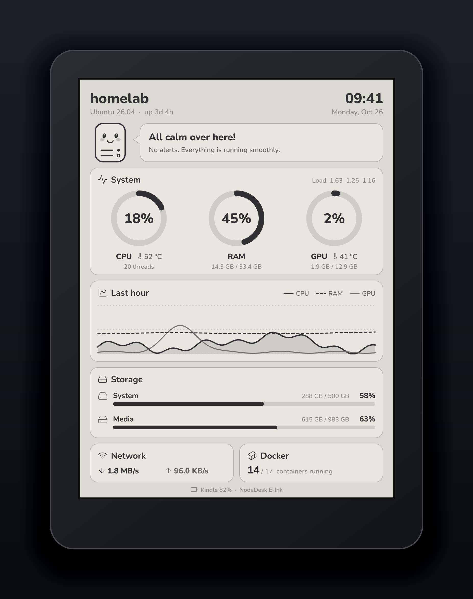

<div align="center">

# NodeDesk E-Ink

**Your home server, on the Kindle you stopped reading on.** A calm, always-on e-ink dashboard in the spirit of [NodeDesk](https://github.com/JonathanLemes/NodeDesk).

`One Go binary` · `No browser on the Kindle` · `16 gray levels` · `MIT`

</div>

<p align="center"></p>

## What it shows

| | |
|---|---|
| **Status** | Nodi, the little server, smiles when everything is fine and sweats when something needs you: a hot CPU or GPU, a disk over 90 %, RAM over 90 %, or a container that keeps restarting or fails its health check. |
| **System** | CPU, RAM and GPU usage as NodeDesk-style rings, with CPU and GPU temperatures, memory and VRAM in use, thread count and load average. |
| **Last hour** | CPU, RAM and GPU history in one chart, told apart by tone and dash (e-ink has no colour). |
| **Storage** | Used / total and a bar for each disk. |
| **Network & Docker** | Current download / upload rate, running and total containers. |
| **Kindle** | Hostname, OS, uptime, time and date, and the Kindle's own battery level. |

English and Portuguese are built in. GPUs: NVIDIA through `nvidia-smi` (no cgo), AMD through sysfs.

## How it works

```
 home server                                   Kindle (jailbroken)
┌──────────────────────────────┐   HTTP      ┌──────────────────────────────┐
│ nodedesk-eink                │◄────────────│ dashboard.sh (busybox sh)    │
│  samples the host every 10 s │  every 60 s │  curl /dashboard.png?w=&h=   │
│  draws a grayscale PNG       │────────────►│  FBInk draws it, full-screen │
└──────────────────────────────┘    PNG      └──────────────────────────────┘
```

All the work happens on the server: it renders the frame in pure Go (no headless browser), at the exact resolution the Kindle asks for, using only tones e-ink can show without dithering. The Kindle only needs `curl` and FBInk, which ship with modern jailbreaks. Layouts scale from the 1236×1648 Paperwhite down to 600×800 Kindles.

## Server

Requirements: Linux and Go ≥ 1.26.

```bash
make install        # builds, installs ~/.local/bin/nodedesk-eink and a systemd --user unit
loginctl enable-linger "$USER"   # optional: keep it running without a login session
```

`make install` also creates `~/.config/nodedesk-eink/env` from [`deploy/env.example`](deploy/env.example). Edit it and run `systemctl --user restart nodedesk-eink`. Open `http://<server>:8421` to preview the dashboard in a browser.

| Variable | Default | |
|---|---|---|
| `NODEDESK_EINK_ADDR` | `:8421` | Listen address. |
| `NODEDESK_EINK_LANG` | `en` | `en` or `pt`. The Kindle can override it per request. |
| `NODEDESK_EINK_NAME` | hostname | Name at the top of the screen. |
| `NODEDESK_EINK_DISKS` | all real filesystems | Disks to show, as `mount=label` pairs: `/=,/mnt/media=Media`. `/` without a label reads "System". |
| `NODEDESK_EINK_DOCKER` | `/var/run/docker.sock` | Docker Engine socket, or `off`. The user running the server must be able to read it. |
| `NODEDESK_EINK_INTERVAL` | `10s` | Sampling interval for the gauges and the one-hour chart. |
| `NODEDESK_EINK_TOKEN` | none | When set, every request except `/healthz` needs `?token=`. |

Endpoints: `/dashboard.png` (query: `w`, `h`, `lang`, `battery`, `charging`, `demo`), `/metrics.json`, `/healthz`, `/` (preview).

The server has no other authentication. Keep it on your LAN or tailnet, or set a token.

## Kindle

You need a jailbroken Kindle with FBInk, which current jailbreaks such as [SpiderCat](https://kindlemodding.org/jailbreaking/SpiderCat/) install for you. Tested on a Paperwhite 5 (firmware 5.18.3).

1. Copy [`kindle/nodedesk-eink/`](kindle/nodedesk-eink) to the root of the Kindle drive and [`kindle/NodeDesk E-Ink.sh`](kindle) to `documents/`. Over USB it is a drag and drop; with SSH, `make kindle-install KINDLE=root@<kindle-ip>` does it (it keeps an existing `config.sh`).
2. Edit `nodedesk-eink/config.sh` and set `SERVER` to your server, e.g. `http://192.168.0.10:8421`.
3. Tap **NodeDesk E-Ink** in the Library.

The Kindle UI steps aside and the dashboard takes the whole screen, refreshing every `INTERVAL` seconds, with a full refresh every `FULL_REFRESH_EVERY` updates to clear ghosting. If the server cannot be reached, the last frame stays and a small line at the bottom says so.

**Press the power button to stop it** and get the normal Kindle UI back. Over SSH: `sh /mnt/us/nodedesk-eink/dashboard.sh stop`. For a one-shot test frame: `dashboard.sh once`. Logs go to `/tmp/nodedesk-eink.log`.

The Kindle stays awake while the dashboard runs, so keep it plugged in for 24/7 use.

## Development

```bash
make test                                        # vet + tests
./bin/nodedesk-eink render -o out.png            # one frame from this machine
./bin/nodedesk-eink render --demo --lang pt -w 600 -h 800 -o out.png
make demo                                        # regenerate the README images
```

```
cmd/nodedesk-eink/   HTTP server and the render command
internal/metrics/    host sampling: CPU, memory, GPU, disks, network, Docker
internal/render/     layout, drawing primitives, Nodi, languages, embedded fonts and icons
kindle/              the client: busybox shell, no dependencies
tools/mockup/        draws the e-reader around the screenshot
```

The layout lives in [`internal/render/render.go`](internal/render/render.go), one function per card, in reference pixels of the 1236×1648 screen. Every gray is a multiple of 17 (see [`draw.go`](internal/render/draw.go)), because panels show 16 levels. To add a language, add an entry to `langs` in [`i18n.go`](internal/render/i18n.go).

Ideas welcome, see [CONTRIBUTING.md](CONTRIBUTING.md). Next on the list: a battery mode that suspends the Kindle between refreshes (it needs to go through the Kindle's `powerd`, writing to `/sys/power/state` is refused), and more cards (services, backups).

## Credits

- [Nunito](https://github.com/googlefonts/nunito) by Vernon Adams and the Nunito Project Authors, SIL Open Font License 1.1 (static instances of the variable font, in [`internal/render/assets/fonts`](internal/render/assets/fonts)).
- [Lucide](https://lucide.dev) icons, ISC License.
- [FBInk](https://github.com/NiLuJe/FBInk) by NiLuJe, and the [Kindle Modding](https://kindlemodding.org) community.
- [gopsutil](https://github.com/shirou/gopsutil), [gg](https://github.com/fogleman/gg), [oksvg](https://github.com/srwiley/oksvg).

Kindle is a trademark of Amazon. This project is not affiliated with Amazon.

## License

[MIT](LICENSE)
